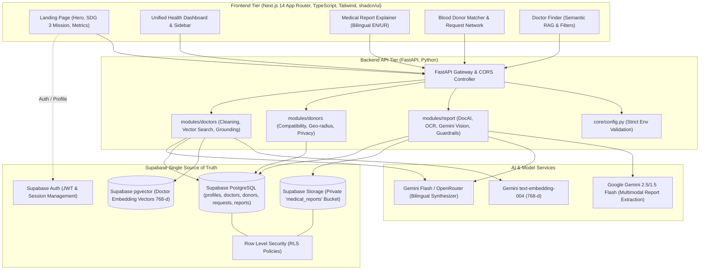

# PULSE BRIDGE — SYSTEM ARCHITECTURE SPECIFICATION
**Version:** 2.0.0-APPROVED-NEXTJS-SUPABASE  
**Author:** Chief Architect & Technical Project Manager  
**Target Milestone:** STCS AI Hackathon & Startup Pitch 2026 (UN SDG 3: Good Health & Well-Being)  
**Strict Code Freeze:** 3:55 PM PKT Sharp  

---

## 1. Executive Summary & Core Mandate

**PULSE BRIDGE** is an enterprise-grade AI healthcare accessibility platform designed to eliminate barriers in medical report literacy, emergency blood donor mobilization, and verified medical specialist discovery across Pakistan.

Following official architectural directives:
- **Frontend:** Built with **Next.js 14+ (App Router)**, **React**, **TypeScript**, **Tailwind CSS**, **shadcn/ui**, **Lucide Icons**, and **Framer Motion**. Streamlit has been completely removed.
- **Backend & Database:** **FastAPI (Python 3.13)** with **Supabase as the single source of truth** (PostgreSQL, Supabase Auth, Supabase Storage, and Supabase `pgvector` with Row Level Security). No secondary databases are permitted.
- **Environment Rigor:** Strict environment variable validation at startup (`backend/.env`, `frontend/.env.local`, root `.env.example`). If required credentials are missing, clear configuration errors are displayed.
- **Clinical & Ethical Boundaries:** Zero medical diagnoses, zero prescribing, strict non-hallucination doctor retrieval, and consent-driven donor contact protection.

---

## 2. System Architecture



---

## 3. Directory Layout & Module Decoupling

```text
D:\Pulse Bridge\
├── .env.example                     # Root template for all environment variables
├── .gitignore                       # Ensures secrets and node_modules are never committed
├── README.md                        # Startup pitch, SDG 3 problem, architecture, setup
├── data/
│   ├── doctors.csv                  # 2,652 verified doctor records (Strictly Read-Only)
│   └── blood_donors.csv             # 100 voluntary donor records (Strictly Read-Only)
├── docs/
│   ├── ARCHITECTURE.md              # System design & component specification
│   ├── DATABASE_SCHEMA.md           # Supabase DDL, RLS, Storage & Data Dictionary
│   ├── API_CONTRACTS.md             # REST API schemas & Pydantic models
│   ├── AGENT_TASKS.md               # 5 Worker ownership specifications
│   └── DEVELOPMENT_PLAN.md          # Hackathon timeline, risks & judging alignment
├── supabase/
│   └── migrations/
│       ├── 01_extensions_and_profiles.sql
│       ├── 02_doctors_and_pgvector.sql
│       ├── 03_donors_and_requests.sql
│       └── 04_report_records_and_storage.sql
├── backend/
│   ├── .env.example
│   ├── .env                         # Gitignored backend secrets
│   ├── requirements.txt
│   ├── main.py                      # FastAPI application entrypoint with CORS
│   ├── core/
│   │   ├── __init__.py
│   │   ├── config.py                # Pydantic Settings with startup validation
│   │   ├── supabase_client.py       # Supabase service client
│   │   └── guardrails.py            # Clinical boundary enforcement
│   ├── modules/
│   │   ├── report/                  # WORKER 2: Medical AI Explainer
│   │   │   ├── __init__.py
│   │   │   ├── parser.py            # PyMuPDF digital PDF extractor
│   │   │   ├── vision_ocr.py        # Gemini Vision multimodal parser
│   │   │   ├── extractor.py         # Biomarker schema extractor
│   │   │   └── explainer.py         # Bilingual EN/UR translation engine
│   │   ├── donors/                  # WORKER 3: Blood Donor Matching
│   │   │   ├── __init__.py
│   │   │   ├── compatibility.py     # ABO/Rh compatibility rules
│   │   │   ├── matcher.py           # Proximity & availability matching
│   │   │   └── service.py           # Registration & request management
│   │   └── doctors/                 # WORKER 4: Doctor RAG & Search
│   │       ├── __init__.py
│   │       ├── cleaner.py           # Non-destructive CSV normalizer
│   │       ├── indexer.py           # Supabase pgvector indexing script
│   │       ├── retriever.py         # Hybrid SQL + vector search
│   │       └── synthesizer.py       # Grounded recommendation generator
│   └── api/
│       ├── __init__.py
│       └── routes.py                # REST endpoints
├── frontend/                        # WORKER 1: Next.js SaaS Web App
│   ├── .env.example
│   ├── .env.local                   # Gitignored frontend public variables
│   ├── package.json
│   ├── tsconfig.json
│   ├── tailwind.config.ts
│   └── src/
│       ├── app/                     # App Router pages (landing, dashboard, reports, doctors, blood)
│       ├── components/              # shadcn/ui components & layouts
│       ├── lib/                     # API client & Supabase browser client
│       └── types/                   # TypeScript interfaces matching API contracts
└── tests/                           # WORKER 5: QA & Integration Tests
    ├── test_env_validation.py
    ├── test_report_explainer.py
    ├── test_blood_matcher.py
    ├── test_doctor_rag.py
    └── test_api_integration.py
```

---

## 4. Technology Stack Justification

| Layer | Technology | Justification |
|---|---|---|
| **Frontend** | Next.js 14 (App Router) + React 18 + TypeScript | Industry standard for production SaaS, fast server rendering, type safety, SEO, seamless client navigation. |
| **Styling & UI** | Tailwind CSS + shadcn/ui + Radix UI + Lucide | Polished healthcare aesthetic, deep navy and teal accents, accessible, responsive components. |
| **Backend API** | FastAPI + Pydantic v2 | High-throughput asynchronous Python, automatic OpenAPI generation, strict request/response validation. |
| **Central Database** | Supabase PostgreSQL 15+ | Enterprise relational integrity, built-in connection pooling, JSONB support for lab biomarkers. |
| **Vector Engine** | Supabase `pgvector` | Seamless relational + vector hybrid queries without operating a standalone vector database. |
| **File Storage** | Supabase Storage (Private Bucket) | Secure encrypted object store for patient lab reports with time-limited signed download URLs. |
| **Authentication** | Supabase Auth (GoTrue) | JWT-based user session handling, passwordless/email login, Row Level Security mapping. |
| **Intelligence** | Google Gemini 2.5/1.5 Flash | Multimodal native vision for dirty lab scans, 1M+ token context window, ultra-fast generation, low cost. |
| **Embeddings** | Gemini `text-embedding-004` (768-d) | High dimensional accuracy on clinical and geographic entities. |

---

## 5. Security & Environment Configuration Model

1. **Strict Startup Validation:**
   - On backend launch, `core/config.py` validates all required environment variables:
     - `SUPABASE_URL`, `SUPABASE_KEY` (Anon/Public), `SUPABASE_SERVICE_ROLE_KEY` (Secret).
     - `GEMINI_API_KEY`.
   - If any key is missing or invalid, the backend fails fast with a descriptive error:
     ```text
     CONFIGURATION ERROR: Required environment variable 'SUPABASE_URL' is missing in backend/.env.
     Please copy .env.example and populate your Supabase credentials before launching.
     ```
2. **Frontend Safety Boundary:**
   - Frontend is strictly prohibited from accessing `SUPABASE_SERVICE_ROLE_KEY`, `GEMINI_API_KEY`, or `OPENROUTER_API_KEY`.
   - Frontend only accesses:
     - `NEXT_PUBLIC_SUPABASE_URL`
     - `NEXT_PUBLIC_SUPABASE_ANON_KEY`
     - `NEXT_PUBLIC_API_URL` (Points to FastAPI backend)
3. **Storage Privacy:**
   - Medical reports are stored in a private bucket (`medical_reports`).
   - Files are uploaded via authenticated backend or signed URLs with expiration. No public access is enabled.
