# PULSE BRIDGE — DEVELOPMENT PLAN & MILESTONES
**Version:** 2.0.0-APPROVED-NEXTJS-SUPABASE  
**Author:** Chief Architect & Technical Project Manager  
**Target Milestone:** STCS AI Hackathon & Startup Pitch 2026 (SDG 3)  
**Strict Code Freeze:** 3:55 PM PKT Sharp  

---

## 1. Hackathon Execution Milestones

```mermaid
gantt
    title Pulse Bridge Development Sprints (Freeze at 3:55 PM Sharp)
    dateFormat  HH:mm
    axisFormat  %H:%M
    
    section M1: Skeletons & Contracts
    Update Docs & Migrations        :done, m1_1, 12:15, 12:30
    Setup Backend & Frontend Scaffold:active, m1_2, 12:30, 12:55
    
    section M2: Core Modules
    Worker 2: Report Multimodal AI  :m2_1, 12:55, 13:40
    Worker 3: Blood Matching Engine :m2_2, 12:55, 13:30
    Worker 4: Doctor RAG & Vector   :m2_3, 12:55, 13:45
    Worker 1: Next.js SaaS Shell    :m2_4, 12:55, 13:45
    
    section M3: Integration
    FastAPI Wireup & Supabase Sync  :m3_1, 13:45, 14:25
    Frontend to API Connectivity    :m3_2, 14:15, 14:50
    
    section M4: Testing & QA
    Worker 5: Pytest & Verification :m4_1, 14:50, 15:15
    
    section M5: Polish & Freeze
    UI Polish, Urdu Nastaliq & Demo :m5_1, 15:15, 15:45
    Final Code Freeze Lock          :crit, m5_2, 15:45, 15:55
```

---

## 2. Milestone Detailed Breakdown

### Milestone M1: Project Skeleton & Shared Contracts
- Update documentation and SQL migrations in `supabase/migrations/`.
- Create `.env.example`, `backend/.env.example`, `frontend/.env.example`.
- Initialize `backend/` with FastAPI, Pydantic settings, and strict startup environment validation.
- Initialize `frontend/` with Next.js, React, TypeScript, Tailwind CSS, Lucide icons, and shadcn/ui.

### Milestone M2: Independent Module Implementation
- **Worker 2 (`backend/modules/report/`):** PyMuPDF parser, Gemini Vision multimodal extraction, structured biomarker JSON output, Urdu/English layman explainer, non-diagnostic guardrails.
- **Worker 3 (`backend/modules/donors/`):** Blood compatibility matrix, proximity distance priority, donor registration, blood request broadcast, WhatsApp contact link generator.
- **Worker 4 (`backend/modules/doctors/`):** Non-destructive CSV normalizer, embedding generation script, Supabase pgvector integration, hybrid search retriever.
- **Worker 1 (`frontend/`):** Next.js landing page, layout & modern sidebar, medical report upload zone, doctor finder UI, blood donor UI.

### Milestone M3: Database & API Integration
- Expose all module endpoints in FastAPI `backend/api/routes.py`.
- Configure CORS for `http://localhost:3000`.
- Integrate Next.js frontend API client with FastAPI backend.
- Seed Supabase PostgreSQL with cleaned doctors and donors data.

### Milestone M4: End-to-End Testing & Verification
- Worker 5 runs automated tests (`tests/test_env_validation.py`, `tests/test_report_explainer.py`, `tests/test_blood_matcher.py`, `tests/test_doctor_rag.py`, `tests/test_api_integration.py`).
- Verify zero hallucination in doctor retrieval (must only recommend doctors from dataset).
- Verify 100% adherence to non-diagnostic/non-prescriptive medical disclaimers.

### Milestone M5: Final Responsive UI Polish, Documentation & Demo Readiness
- Polish typography (Urdu Nastaliq font, accessible contrast, responsive mobile/tablet layout).
- Verify empty states, loading skeletons, and user feedback toast alerts.
- Finalize `README.md` with problem statement, startup model, AI architecture, and setup instructions.
- Ensure all commits are clean, tag release, and lock project before **3:55 PM sharp**.
